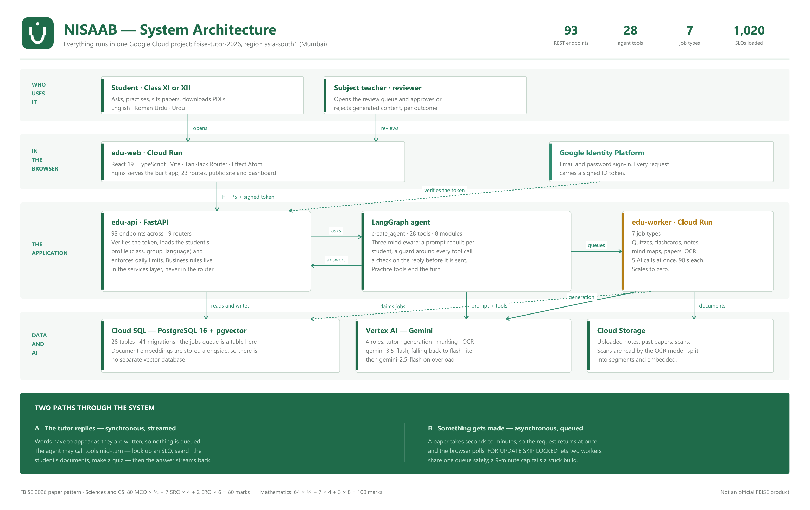

> **Superseded.** This describes an earlier version of NISAAB and is no
> longer maintained. The current documentation is
> [docs/handbook](../handbook/README.md), written 9 November 2026.
> This file is kept only so older links still resolve.

# 7. System Architecture

## 7.1 Overview

NISAAB is a monorepo that holds six Python packages and one TypeScript application. It is deployed as three independent services plus scheduled jobs, all on Google Cloud.



*Figure 1. NISAAB system architecture.*

## 7.2 Components

| Component | Role |
|---|---|
| `edu-web` | React 19 single-page application, built into static files and served by Firebase Hosting on `nisaab.muhammadsaadcheema.com`. |
| `edu-api` | FastAPI service. Verifies sign-in tokens, reads and writes the database, runs the agent, streams replies and adds long jobs to the queue. |
| `edu-worker` | Background processor on Cloud Run. Claims jobs from the queue and runs document indexing and content generation. It is private. |
| PostgreSQL 16 + pgvector | Cloud SQL. Holds all application data, vectors for search and the job queue. |
| Cloud Storage | Uploaded documents and extracted text. |
| Vertex AI | Gemini models for the tutor, generation, marking and OCR. |
| Identity Platform | Sign-in and ID tokens. |
| Secret Manager | Database connection string and API keys, mounted as environment variables. |
| Cloud Scheduler | Calls the worker's drain endpoint every minute. |

## 7.3 Request flow

1. The browser sends an HTTPS request to `edu-api` with a Firebase ID token in the `Authorization` header.
2. `edu-api` verifies the token against Google's published keys.
3. `edu-api` reads or writes PostgreSQL over a private Unix socket.
4. For a chat message it runs the agent, which calls Vertex AI and its tools, and streams the reply back as Server-Sent Events.
5. For long work (a board paper, document indexing, generation) it adds a row to the `jobs` table and returns at once.
6. `edu-worker` claims the job, runs it and writes the result to the database. The interface polls until the item is ready.

## 7.4 Repository layout

```
edu-agent/
  src/
    edu-web/            React 19 + TypeScript single-page application
    edu-api/            FastAPI HTTP service
    edu-worker/         background job processor
    shared/
      db/               SQLAlchemy models, Alembic migrations
      core/             business services (quizzes, papers, marking, mastery)
      ai/               agent, tools, prompts, LLM abstraction
      queue/            PostgreSQL-backed job queue
  scripts/              syllabus parsers, content generation, end-to-end tests
  deploy/gcp/           infrastructure and deployment script
```

The Python packages form a `uv` workspace. Each declares its own dependencies and they depend on one another explicitly. The repository is private and is managed with Git.
