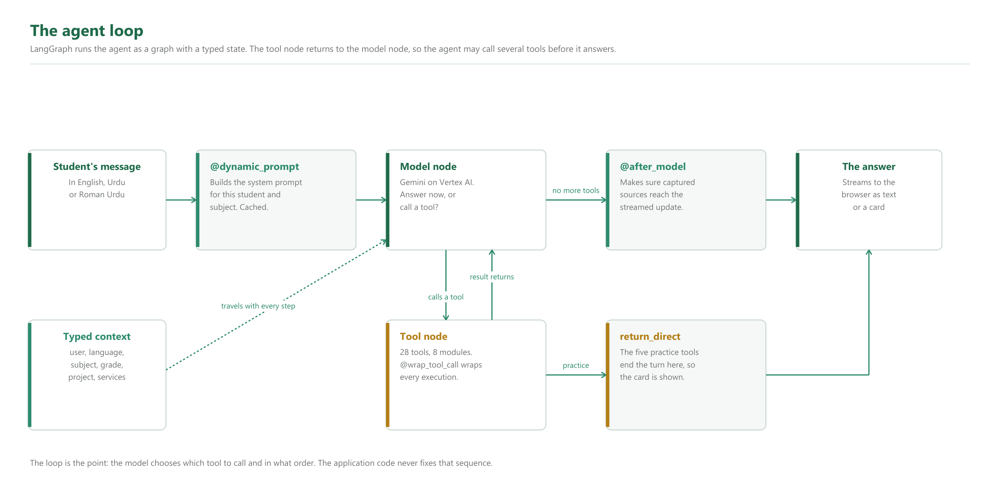

> **Superseded.** This describes an earlier version of NISAAB and is no
> longer maintained. The current documentation is
> [docs/handbook](../handbook/README.md), written 9 November 2026.
> This file is kept only so older links still resolve.

# 11. The AI Layer

## 11.1 Model access and roles

Models are reached through Vertex AI's OpenAI-compatible endpoint, using a custom subclass of LangChain's `ChatOpenAI`. Authentication uses a Google service-account token that is refreshed automatically, not a fixed key. Four model roles are configured separately, so a change for one purpose does not disturb the others.

| Role | Used for |
|---|---|
| `TUTOR` | The conversational agent |
| `GENERATION` | Quizzes, flashcards, notes, mind maps, explainers and stimulus sets |
| `MARKING` | Grading written answers against a mark scheme |
| `OCR` | Reading text from images and scanned documents |

In the September build the main model was Gemini 3.5 Flash, with Gemini 3.5 Flash-Lite and Gemini 2.5 Flash as fallbacks, and `gemini-embedding-001` for embeddings.

## 11.2 Resilience

- **Fallback chain.** A configured list of alternative models. A rate limit or server error moves the call to the next model instead of failing the request.
- **Tool-call signatures.** Gemini returns an opaque signature with each tool call and rejects a follow-up request unless that signature is sent back unchanged. The base client throws it away. The subclass keeps it and sends it back.

## 11.3 Prompts

Prompts are Jinja2 templates, not strings in the code. Fifteen templates cover the tutor, quiz generation, flashcards, explainers, short and extended response generation, marking, mind maps, stimulus sets, study plans and topic graphs. Templates take structured variables, so one template serves every subject. Subject rules are conditional, so adding a subject does not need a new template.

```jinja
You are NISAAB, an expert FBISE {{ subject }} tutor for {{ grade_label }} students...

- Programs are in Python 3, as in the FBISE syllabus. Put code in a fenced
  block starting with ```python. Never write code in LaTeX or between $...$.

```

## 11.4 Syllabus retrieval

Matching a question to an outcome is a search over a small, fixed and carefully checked collection. NISAAB therefore scores outcomes by term rarity. Each word in the question is weighted by how rare it is across the subject's outcomes, so a distinctive word such as "projectile" counts far more than a common one such as "effect". An outcome must carry at least half of the question's total weight to be returned at all, which removes weak matches. An explicit code such as `P-11-B-05` skips the search.

```
weight(word) = log((N + 1) / (documents_containing(word) + 1)) + 1
score(slo)   = sum over query words of weight(word) x matches(word, slo)
N            = number of outcomes in the subject
```

## 11.5 Document retrieval

A student's uploaded notes are an unknown collection in unpredictable language, where meaning matters more than exact words. The text is split into segments, and each segment is embedded as a 3072-dimensional vector in pgvector. A query is embedded the same way and compared by cosine similarity. Retrieval first finds the requesting project's own document identifiers and searches only those, so one student's material can never reach another.

## 11.6 Content bank and generation

Practice requests first take matching items from the bank, filtered by question type and cognitive level, and ask the model only for the rest. When the model is needed, the work is divided into small batches that run at the same time, because one request for many worked numerical problems is much slower than several small ones in parallel. Each batch is told which batch it is, so parallel batches do not write the same question.

## 11.7 The agent

Above the model API sits an agent built with LangGraph through LangChain's `create_agent`. LangGraph describes an agent as a directed graph with a typed state. Nodes are steps (call the model, run a tool) and edges are transitions. Because the graph can go from the tool node back to the model node, the agent loops: it may call several tools, in an order it chooses, before it answers.



*Figure 2. The agent loop.*

| A plain API call | NISAAB's agent layer |
|---|---|
| One prompt, one completion | A loop: the model may call tools many times before answering |
| The developer decides what data to fetch | The model decides which tool to call |
| No structure carried between steps | A typed state object travels through every step |
| No point to intercept | Middleware wraps the model call and every tool call |
| The output is text | The output may be text, or a quiz, paper or mind map shown as an interactive card |

## 11.8 Typed context and state

Two typed objects travel with every step. The context is fixed for a request and the state builds up. Services are passed in through the context instead of being created inside tools, so a tool depends only on its arguments and that context, which makes it easy to test alone.

```python
class ChatbotContext(BaseModel):
    user_id: str
    language: str                   # en, ur, ur-Latn
    fbise: FbiseContext | None      # subject, grade, curriculum, has_slos
    project_id: str
    search: SearchService           # injected, not imported inside tools
    queue: QueueService
    llm: BaseChatModel | None

class ChatbotState(AgentState):
    sources: list[dict]             # documents cited, shown in the interface
```

## 11.9 Middleware

| Hook | Purpose |
|---|---|
| `@dynamic_prompt` | Builds the system prompt for each request from the subject, grade, curriculum, language and whether web search is set up. Cached by that combination. |
| `@wrap_tool_call` | Wraps every tool execution. Used to capture document sources from retrieval results so the interface can show citations. |
| `@after_model` | Runs after each model step and makes sure captured sources are in the streamed update. |

## 11.10 Tools

Each tool is an async function with a typed signature and a docstring. The model reads the docstring to decide whether the tool applies.

| Module | Tools |
|---|---|
| `syllabus` | `find_syllabus_slos` |
| `rag` | `search_project_documents` |
| `web` | `search_web` (registered only when configured) |
| `practice` | `ask_practice_questions`, `practice_quiz`, `practice_flashcards`, `practice_mind_map`, `practice_paper` |
| `quiz` | `create_quiz`, `create_quiz_scoped`, `list_quizzes`, `get_questions`, `delete_quiz` |
| `flashcard` | `create_flashcards`, `create_flashcards_scoped`, `list_groups`, `get_flashcards`, `delete_group`, `update_group` |
| `note` | `create_note`, `create_note_scoped`, `list_notes`, `get_note`, `delete_note` |
| `mind_map` | `create_mind_map`, `create_mind_map_scoped`, `list_mind_maps`, `get_mind_map` |

## 11.11 Tools that end the turn

The practice tools are marked `return_direct`. When one runs, its result ends the agent's turn at once instead of going back to the model for another reply. This lets the interface show an interactive quiz, paper or mind-map card and stops the model from writing the questions out again in the chat.

## 11.12 Asking before acting

`ask_practice_questions` does not produce content. It returns a few questions for the student to answer first, and the model calls it when a request is too vague, for example "quiz do". The server adds one question built from the real syllabus, listing actual outcome codes, with the student's weakest outcomes already selected from their mastery record. The answers come back as an ordinary message, and the model then calls the real tool with those settings.

## 11.13 Constraints on the agent

An agent that can call tools can also misuse them. Three rules are set in the system prompt and checked by the automated tests.

- **Syllabus content never comes from the web.** `search_web` is for board announcements and out-of-syllabus questions only. The test suite fails if an ordinary Physics question triggers a web search.
- **Outcome codes may not be invented.** Only codes returned by `find_syllabus_slos` may be cited.
- **One tool call per practice request.** The practice tools find their own outcomes, so the model must not call the syllabus tool first.

## 11.14 Worked example

```
Student: "projectile ki range kaise nikalte hain?"
  -> agent decides it needs the syllabus, calls find_syllabus_slos('projectile range')
  -> tool returns SLO P-11-B-05, Mechanics, Summative, level U/A, with its explainer
  -> agent writes the answer in Roman Urdu, cites 'SLO P-11-B-05', derives the formula

Student: "is par 5 numericals do"
  -> agent calls practice_quiz(slo_codes=['P-11-B-05'], style='numerical',
                               level='board', count=5)
  -> tool pulls 5 matching questions from the bank (no model call)
  -> return_direct ends the turn so the interface shows a quiz card
```

The model chose both tool calls. Neither was fixed in the application code.
