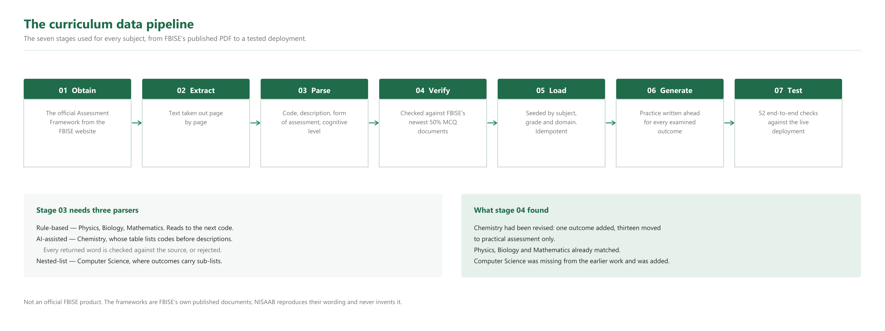

# 13. Curriculum Data Pipeline

*Figure 3. The seven stages used for every subject.*

## 13.1 Stages

| Stage | Action |
|---|---|
| 01 | Obtain the official Assessment Framework from the FBISE website. |
| 02 | Extract the text page by page. |
| 03 | Parse the outcome table: code, description, form of assessment, cognitive level. |
| 04 | Verify against FBISE's newest documents for the 50% MCQ pattern and correct differences. |
| 05 | Load the verified outcomes into the database by subject, grade and domain. |
| 06 | Generate practice material in advance for every examined outcome. |
| 07 | Test the whole system end to end against the live deployment. |

## 13.2 The three parsers

Extraction was the hardest stage. The frameworks are PDFs where table cells wrap across lines and pages, and each subject is laid out differently.

| Parser | Subjects | Approach |
|---|---|---|
| Rule-based | Physics, Biology, Mathematics | Finds each outcome code, takes the text up to the next code and removes the table's fixed vocabulary. |
| AI-assisted | Chemistry | The table lists several codes before their descriptions, which breaks the rule-based method. The model matches descriptions to codes under the safeguards below. |
| Nested-list | Computer Science | Outcomes are broad and are followed by nested lists of what a student must understand, know and be able to do. |

## 13.3 Safeguards on the AI-assisted parser

The goal is to copy FBISE's wording faithfully and never invent it, so the parser has two checks.

1. The outcome codes are found by a regular expression over the document text, and the model must return exactly those codes.
2. Every description the model returns is checked word by word against the source text. A description containing any word that is not in the document is rejected.

## 13.4 What verification found

Comparing with FBISE's newest documents showed that Chemistry had been revised: one outcome was added and thirteen were moved to practical assessment only. Physics, Biology and Mathematics already matched. Computer Science was missing from the earlier work and was added.

## 13.5 Loading and re-loading

The curriculum seed is idempotent. Outcomes are matched by code, updated if they have changed and removed if they have been withdrawn, so running it again is safe. This is how a revised framework is loaded without rebuilding anything.
