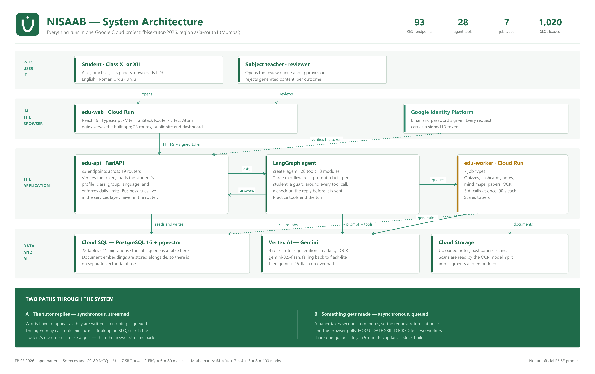

# 3 · Architecture

[← User guide](02-user-guide.md) · [Contents](README.md) · [Next: Backend →](04-backend.md)

---

## The shape of the system

Three Cloud Run services, one database, one bucket. Nothing else holds state.



*Figure 1 — System architecture. Solid arrows are the request path; dashed ones
are checks and queue reads.*

### Why there is no Redis and no Celery

The job queue is **a Postgres table**. Claiming work is one statement:

```sql
UPDATE jobs SET status = 'running', attempts = attempts + 1, locked_at = now()
WHERE id IN (
  SELECT id FROM jobs
  WHERE status = 'queued' AND run_after <= now()
  ORDER BY created_at
  FOR UPDATE SKIP LOCKED
  LIMIT :limit
)
RETURNING id, type, payload, attempts, max_attempts
```

`FOR UPDATE SKIP LOCKED` is what makes this safe: two workers running the same statement
at the same time cannot claim the same row — the second one skips it and takes the next.

That buys a lot for a project this size:

- **One less service** to deploy, pay for, secure and monitor.
- **Jobs are transactional with the data they describe** — no "row saved but message
  lost" window between the database and a separate broker.
- **Retries and stale-job recovery are rows**, inspectable with ordinary SQL.

The cost is that it will not scale to millions of jobs a minute. For an FSc cohort it
is not close to the limit, and the simplicity is worth more.

---

## Two paths through the system

Everything NISAAB does follows one of these.

### Path A — the tutor replies (synchronous, streamed)

Used for chat. The student should see words appearing, so nothing is queued.

```
  browser                 edu-api                    agent                Vertex AI
     │  POST /chats/…/messages │                        │                      │
     ├────────────────────────►│                        │                      │
     │                         │  build context         │                      │
     │                         │  (profile, SLOs, docs) │                      │
     │                         ├───────────────────────►│                      │
     │                         │                        │  prompt + 28 tools   │
     │                         │                        ├─────────────────────►│
     │                         │                        │◄─ tool call ─────────┤
     │                         │                        │                      │
     │                         │                        │  run tool, loop      │
     │◄═ server-sent tokens ═══╪════════════════════════╪══════════════════════┤
     │                         │  persist the message   │                      │
```

The agent may call tools mid-turn — look up an SLO, search the student's documents,
create a quiz. Some tools are `return_direct`: they end the turn immediately, because
once a quiz exists there is nothing left to say about it.

### Path B — something gets made (asynchronous, queued)

Used for quizzes, flashcards, notes, mind maps, papers, document processing and chat
titles. These take seconds to minutes, so the request returns at once.

```
  browser            edu-api           jobs table          edu-worker
     │  POST …/papers    │                  │                   │
     ├──────────────────►│                  │                   │
     │                   ├─ INSERT job ────►│                   │
     │◄─ 201 "preparing" ┤                  │                   │
     │                   │                  │◄── claim ─────────┤
     │  GET …/papers/id  │                  │                   │ builds it
     ├──────────────────►│                  │                   │ (AI calls,
     │◄─ still preparing ┤                  │                   │  5 at a time)
     │       … polls …   │                  │                   │
     │                   │                  │◄── complete ──────┤
     │  GET …/papers/id  │                  │                   │
     ├──────────────────►│                  │                   │
     │◄─ 200 ready ──────┤                  │                   │
```

The browser polls; the record carries a `status` the UI reads. A paper that is still
being written shows a placeholder and no download button.

#### Guard rails on Path B

Three limits, all learned the hard way:

| Setting | Value | Why |
|---|---|---|
| `AI_CONCURRENCY` | 5 | Eight at once rate-limited us at Vertex, and every 429 is paid for twice — once in the backoff, once in the retry |
| `llm_request_timeout` | 90 s | Without it a stalled connection hangs forever; a paper once ran 9+ minutes because no timeout existed |
| `BUILD_TIMEOUT_SECONDS` | 9 min | Past this the build is stuck, not slow — fail it so the student is offered another go instead of an endless spinner |

---

## The repository

A `uv` workspace. Shared code is packaged, not copied.

```
edu-agent/
├── src/
│   ├── edu-api/          FastAPI service — routers, auth, settings
│   ├── edu-worker/       background worker — processors per job type
│   ├── edu-web/          React 19 + Vite + TypeScript
│   └── shared/
│       ├── core/         services: the business logic (22 modules)
│       ├── db/           SQLAlchemy models + 41 Alembic migrations
│       ├── ai/           agent, 28 tools, prompts, model routing
│       └── queue/        the Postgres-backed job queue
├── scripts/
│   ├── seed/data/        the FBISE curriculum, as JSON
│   ├── content/          content generation and fix-up scripts
│   └── admin/            one-off operational scripts
├── deploy/gcp/           deploy.sh and its settings
└── docs/nisaab/          this documentation
```

### Where logic is allowed to live

This separation is enforced by habit, and it is why the code stays navigable:

| Layer | May contain | May **not** contain |
|---|---|---|
| `routers/` | HTTP shape, status codes, auth | business rules |
| `shared/core/services/` | all business rules | HTTP, SQL strings, env reading |
| `shared/db/` | models, migrations | business rules |
| `shared/ai/` | prompts, tools, model routing | persistence decisions |

Config is **passed in**, never read from the environment inside a service. That is why
`GoogleFormsService` takes its credentials as arguments rather than reading them — it
keeps the service testable and the settings in one place.

---

[← User guide](02-user-guide.md) · [Contents](README.md) · [Next: Backend →](04-backend.md)
